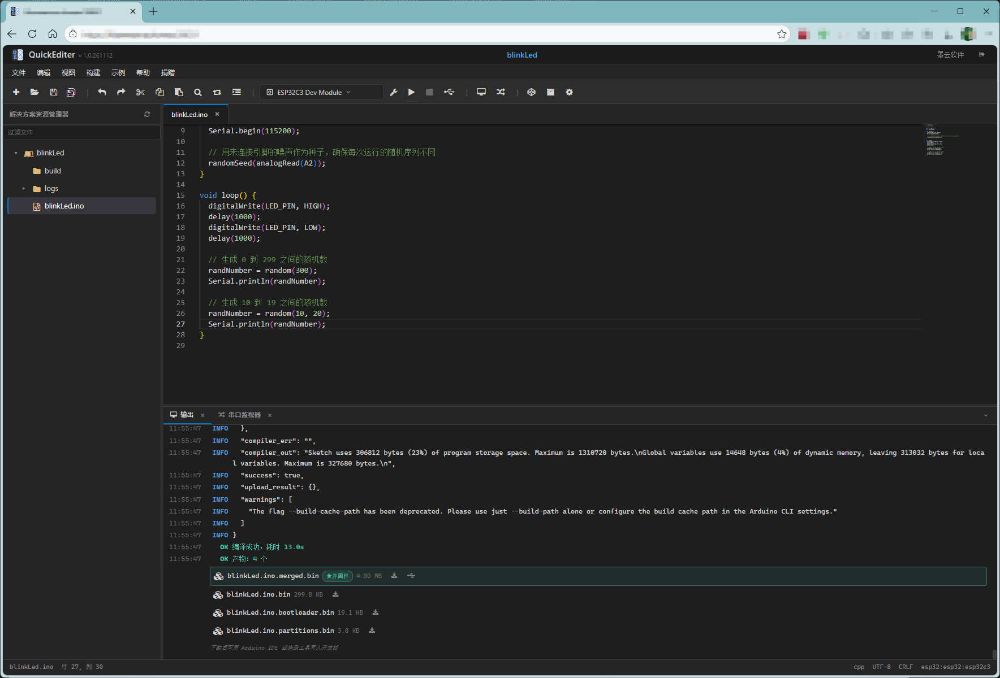
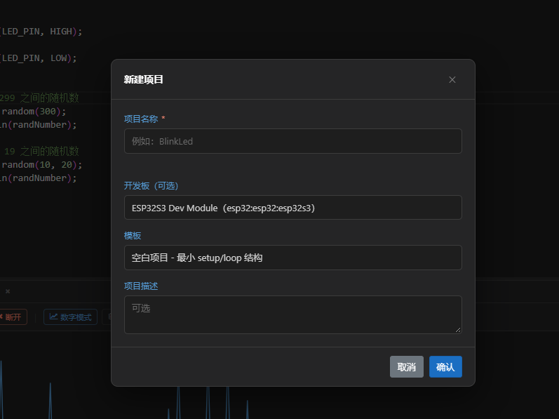
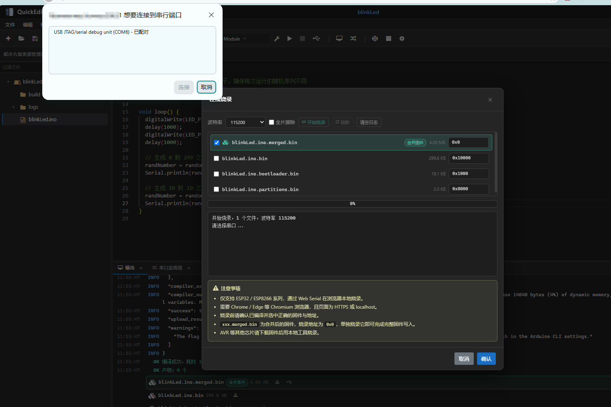
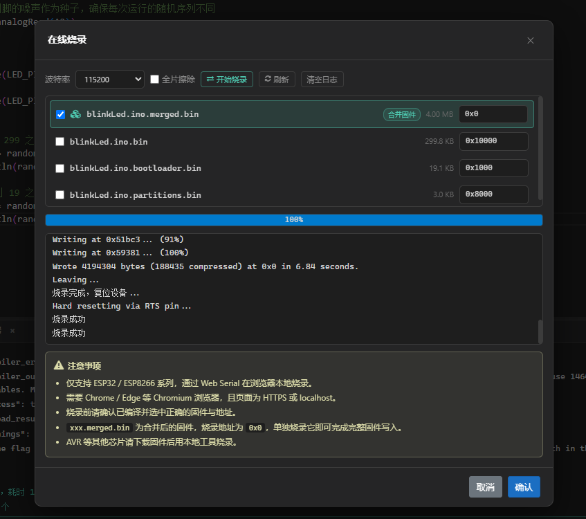
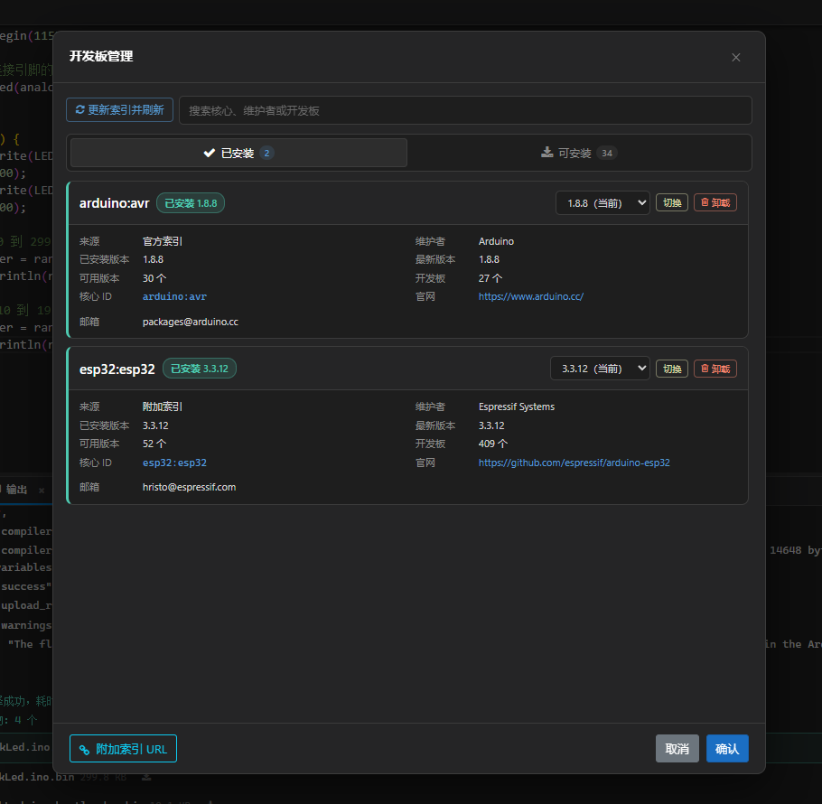
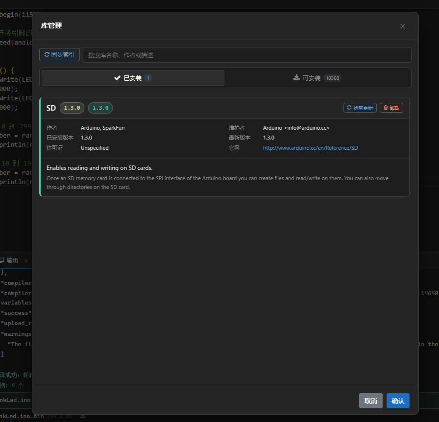
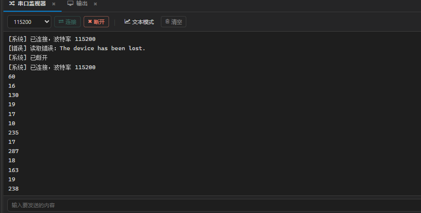
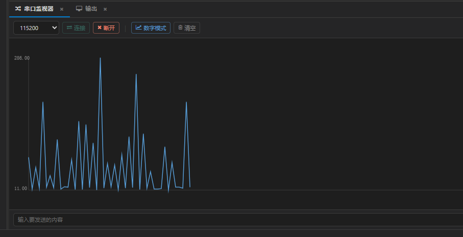

# QuickEditer

基于 Arduino 的 Web IDE，面向嵌入式开发场景，提供从项目创建、代码编辑到编译烧录的完整工作流。支持多项目与文件树管理、C/C++ 语法高亮与常用函数补全、一键编译并实时查看日志；编译产物自动识别，ESP32/ESP8266 可合并为单一固件；通过浏览器 Web Serial 直接烧录，无需安装本地工具。内置开发板与库管理、串口监视器、示例浏览、全局搜索与主题切换，适配 Windows 与 Linux 服务器部署，数据集中存放，便于备份与迁移。

**注意将项目中的文件夹`Arduinolib`复制到生成目录！！**



## 功能

### 项目管理
- 新建项目，支持空白、Blink、串口打印、WiFi 连接等模板
- 打开历史项目，最近项目列表
- 项目设置：描述、库依赖
- 项目导出 ZIP
- 文件树浏览，新建文件/文件夹、重命名、删除、上传、拖拽移动
- 文件类型图标区分：代码、文本、数据、图片、固件

### 代码编辑
- 基于 Monaco Editor，C/C++ 语法高亮
- 多页签，拖动排序，中键关闭，未保存标记
- 查找替换、多光标、列选择、代码折叠
- Arduino 常用函数补全
- 切换页签恢复滚动位置
- 只读文件标识与保护
- 全局搜索，跨文件匹配，跳转定位

### 编译
- 调用 arduino-cli 编译，实时输出日志
- 编译前检查库依赖
- 支持取消编译
- 编译日志按时间保存，保留最近 20 个
- 中间文件与缓存限制在项目目录内
- ESP32/ESP8266 自动合并固件

### 在线烧录
- 基于 Web Serial，浏览器直接烧录 ESP32/ESP8266
- 无需安装本地工具，Chrome/Edge 支持
- 优先使用合并固件，地址 0x0
- 支持多文件烧录，地址可修改
- 烧录日志实时显示，支持全片擦除

### 开发板与库管理
- 核心安装、卸载、更新、版本切换
- 库安装、卸载、检查更新
- 附加索引 URL 配置
- 实时日志显示安装过程
- 本地缓存优先
- 开发板配置项修改

### 串口监视器
- 文本模式与数字模式折线图
- 多列数据、自动 Y 轴
- 支持发送文本
- 波特率 9600–921600

### 其他
- 示例浏览
- 关于弹窗
- 帮助文档
- 深色/浅色主题
- 登录认证，首次改密，错误锁定，7 天免密
- 可调侧栏宽度、面板高度
- 面板状态记忆
- 捐赠入口

## 技术栈
- .NET 8 / ASP.NET Core Blazor Server
- Monaco Editor（BlazorMonaco）
- arduino-cli
- esptool-js
- Web Serial API
- FontAwesome

## 目录结构
```
QuickEditer/
├── Arduinolib/                    arduino-cli 原始文件（按平台分目录）
│   ├── linux_32/
│   ├── linux_64/
│   ├── win_32/
│   └── win_64/
├── Components/
│   ├── App.razor
│   ├── Routes.razor
│   ├── Layout/                    布局
│   ├── Pages/                     页面（Index、Login、Help）
│   └── Share/                     共享组件（工具栏、编辑器、弹窗等）
├── Core/                          配置、工具、文件类型
├── Models/                        数据模型
├── Services/                      业务服务
├── wwwroot/
│   ├── css/                       全局样式
│   ├── js/                        前端脚本
│   ├── images/                    图片资源
│   └── lib/esptool/               浏览器端烧录库
└── Data/                          运行时数据（首次启动生成）
    ├── Projects/                  项目目录
    ├── ArduinoCore/               arduino-cli 与核心、库
    ├── certs/                     HTTPS 证书
    ├── setting.xml                全局配置
    └── auth.xml                   认证信息
```


## 快速开始

### 环境要求
- .NET 8 SDK
- arduino-cli（放入 Arduinolib/{平台}/）
- Python 3.10+（ESP 核心编译需要）
- Chrome/Edge

### 构建运行
```bash
dotnet build
dotnet run
```

默认监听 http://localhost:58631

### 指定数据目录
```bash
dotnet run -- /path/to/data-parent
```
### 首次登录
- 初始密码：`quickadmin`
- 强制修改密码，至少 8 位，含大小写、数字、特殊字符
- 连续 5 次错误锁定 30 分钟

### HTTPS
将证书文件 `ssl.pem` 和 `ssl.key` 放入 `Data/certs/`，重启服务自动启用 HTTPS。证书格式为 PEM，私钥不能加密。

### 端口修改
编辑 `Data/setting.xml` 的 HttpPort 字段，或在应用设置中修改，重启服务生效。

数据位置说明
所有运行时数据在 `Data/` 目录：
- Projects/：项目源码、配置、编译产物、日志
- ArduinoCore/：arduino-cli、核心、库、缓存
- certs/：HTTPS 证书
- setting.xml：全局配置
- auth.xml：认证信息

备份直接复制整个 Data/ 目录。迁移到新服务器时，复制 Data/ 和程序文件，Arduinolib/ 一并迁移。

### 常见问题
#### 编译提示未找到 arduino-cli
检查 `Data/ArduinoCore/` 下是否有对应平台的可执行文件。首次启动会从 Arduinolib/{平台}/ 复制。
#### 编译提示 python3 找不到
ESP32/ESP8266 核心编译需要 Python 3，Linux 服务器安装 python3，推荐 3.10 以上。
#### 在线烧录时浏览器没有弹出串口选择
确认浏览器为 Chrome/Edge，页面为 HTTPS 或 localhost，允许串口权限。
#### 烧录合并固件后设备不启动
合并固件地址固定 0x0，若设备之前烧过自定义分区表，勾选「全片擦除」后重试。
#### 忘记密码
删除 `Data/auth.xml`，重启服务，恢复初始密码 `quickadmin`。
#### 页面连接断开
Blazor Server 依赖 WebSocket，网络波动或服务重启会断开，页面会显示重连提示，自动重试后给出刷新按钮。

### 许可
本项目仅供学习和个人使用。使用 arduino-cli、esptool-js、Monaco Editor 等第三方组件时，请遵守各自的开源协议。

### 支持
本软件完全免费，无任何功能限制。如果对你有帮助，欢迎在应用内「捐赠」菜单扫码支持作者。


## 其他截图
新建项目

基于WebSerial串口链接

基于Web的固件烧录（目前只支持 ESP32/ESP8266项目）

开发板管理

库管理

串口监视-文本模式

串口监视-图形模式

